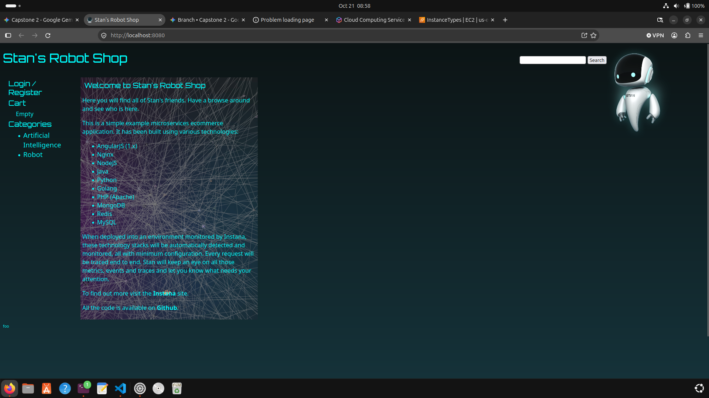
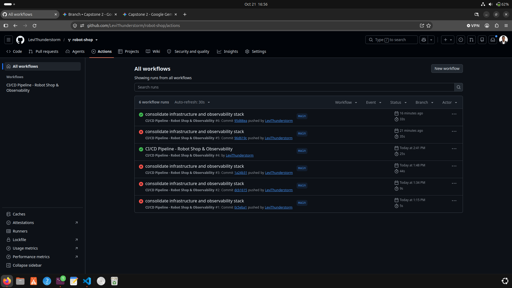
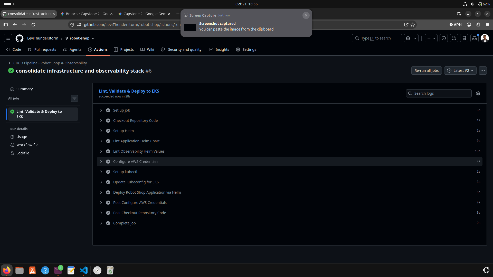
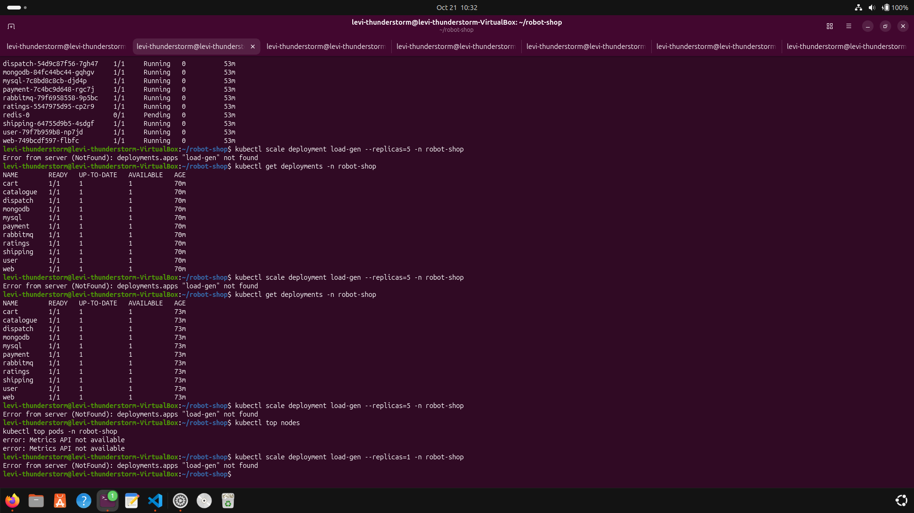
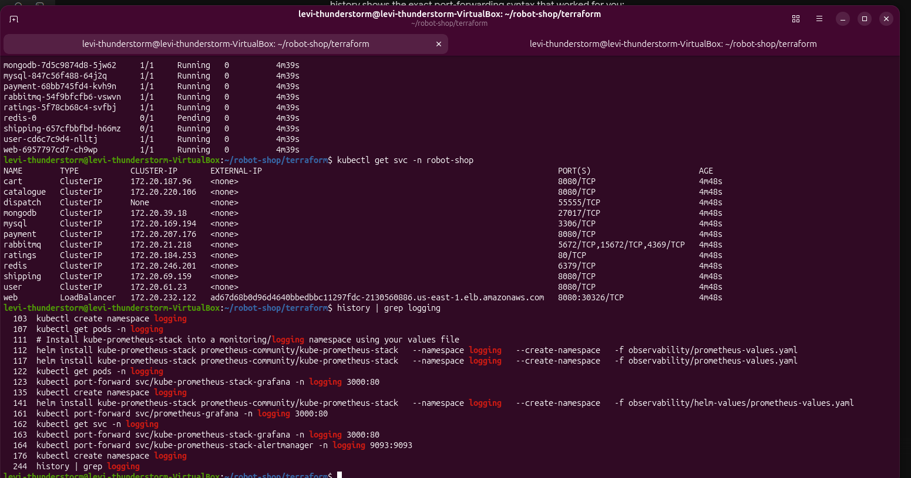
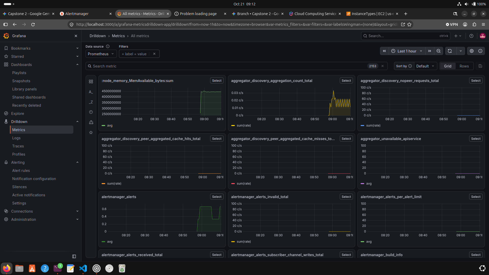
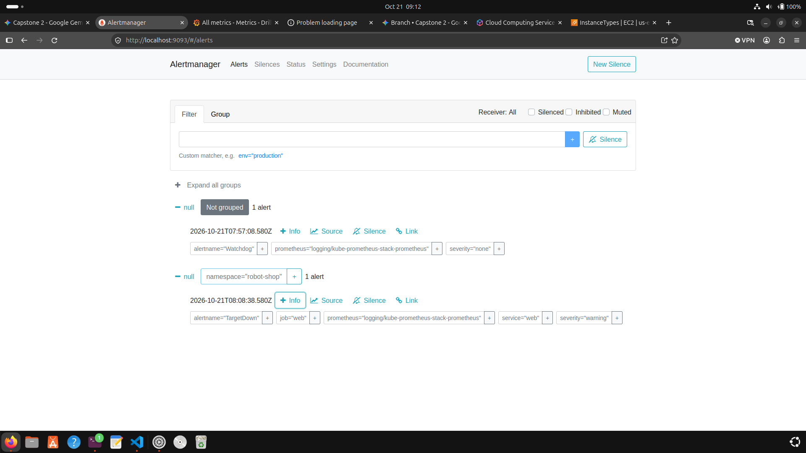
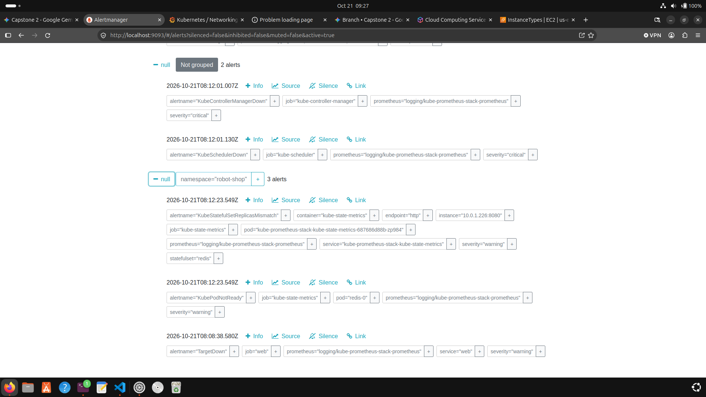

# Automated EKS Deployment & Observability with Chaos Resilience Testing

A cloud-native DevOps project demonstrating the deployment, observability, and automated CI/CD integration of the microservices-based **Instana Robot Shop** application on **Amazon EKS (Elastic Kubernetes Service)** using **Terraform**, **Helm**, **GitHub Actions**, **Prometheus**, and **Grafana**.

---

## 🏗️ Architecture Overview



The application architecture utilizes standard Kubernetes microservices deployed onto AWS infrastructure managed via Terraform:

* **Cloud Provider:** Amazon Web Services (AWS)

* **Container Orchestration:** AWS EKS (`voting-app-cluster`)

* **Namespace:** `robot-shop`

* **Observability Stack:** `kube-prometheus-stack` in the `logging` namespace (Prometheus, Grafana, Alertmanager)

* **In-Cluster Services:** `cart`, `catalogue`, `dispatch`, `mongodb`, `mysql`, `payment`, `rabbitmq`, `ratings`, `redis`, `shipping`, `user`, `web`

## 💡 Strategic Architecture Choice: Hybrid Deployment Model

To strike a balance between real-world enterprise CI/CD practices and strict **cost optimization / billing control**, this project implements a **Hybrid Deployment Strategy**:

1. **Manual Infrastructure Control (`Terraform Apply / Destroy`):**

   * Infrastructure as Code (IaC) is written using Terraform to provision the custom VPC, subnets, route tables, internet gateways, and EKS cluster (`voting-app-cluster`).

   * **Why Manual Execution?** To prevent unexpected AWS cloud costs resulting from automated background triggers or forgotten test clusters, `terraform apply` and `terraform destroy` are run intentionally by the engineer. This ensures the environment is active only during testing and tear-down is explicitly executed when drills conclude.

2. **Automated Application CI/CD (`GitHub Actions`):**

   * Application code validation, build checks, standardizing manifests, and cluster updates are handled continuously via `.github/workflows/ci-cd.yml`.

   * Pushing to the main branch triggers automated checks and securely communicates with EKS to deploy workloads via `kubectl` and `Helm`.

     

     

## 📊 Observability & Monitoring Setup

The monitoring stack was deployed using Helm via the `kube-prometheus-stack` inside the `logging` namespace:

* **Prometheus:** Scrapes metrics across application namespaces (`robot-shop`) and node health indicators.

* **Grafana:** Visualizes traffic, request rates, pod counts, and resource constraints using custom PromQL queries:

  ```
  sum(rate(http_requests_total{namespace="robot-shop"}[1m])) by (status, path)
  
  ```

* **Alertmanager:** Configured to monitor system thresholds, notifying on state mismatches and missing target scrapers.

* **Local Service Access:** Attained securely via `kubectl port-forward`:

  

  

  * **Grafana:** `kubectl port-forward svc/kube-prometheus-stack-grafana 3000:80 -n logging`

    

  * **Alertmanager:** `kubectl port-forward svc/kube-prometheus-stack-alertmanager 9093:9093 -n logging`

    

    

## 🧪 Chaos Engineering & Resilience Testing

To validate that the observability pipeline accurately captures system failure modes, chaos engineering experiments were conducted on live workloads:

### Drill 1: Service Dependency Termination

* **Action:** Scaled down core microservice deployments (`catalogue`) and stateful workloads (`redis`) to `0` replicas using `kubectl scale`.

* **Observed Alerts in Alertmanager & Grafana:**

  1. **`TargetDown` (`job="web"`):** Captured immediately as scraping endpoints failed.

  2. **`KubePodNotReady` (`pod="redis-0"`):** Triggered when dependent stateful sets failed health checks.

  3. **`KubeStatefulSetReplicasMismatch`:** Triggered due to expected vs. actual replica counts.

### Drill 2: Synthetic Traffic Verification

* Traffic spikes and HTTP request rates were verified using terminal-driven request loops (`curl -s -o /dev/null http://localhost:8080/`) to observe real-time rate metrics on Grafana dashboards during recovery phases.

## 🚀 CI/CD Pipeline Workflow

The automated deployment pipeline (`.github/workflows/ci-cd.yml`) performs the following automated steps:

```
name: CI/CD Pipeline

on:
  push:
    branches: [ "main" ]
  pull_request:
    branches: [ "main" ]

jobs:
  build-and-test:
    name: Build & Validate
    runs-on: ubuntu-latest
    steps:
      - uses: actions/checkout@v4
      - name: Validate Code & Formatting
        run: echo "Running syntax and manifest verification..."

  deploy-to-eks:
    name: Deploy to AWS EKS
    needs: build-and-test
    if: github.event_name == 'push' && github.ref == 'refs/heads/main'
    runs-on: ubuntu-latest
    steps:
      - uses: actions/checkout@v4
      - name: Configure AWS Credentials
        uses: aws-actions/configure-aws-credentials@v4
        with:
          aws-access-key-id: ${{ secrets.AWS_ACCESS_KEY_ID }}
          aws-secret-access-key: ${{ secrets.AWS_SECRET_ACCESS_KEY }}
          aws-region: us-east-1
      - name: Update Kubeconfig
        run: aws eks update-kubeconfig --name voting-app-cluster --region us-east-1
      - name: Deploy Workloads
        run: |
          kubectl apply -f manifest/ -n robot-shop

```

## 🧹 Tear-down & Infrastructure Lifecycle

Because resources were provisioned using Terraform under strict manual cost governance, tearing down the environment follows a clean, dependency-aware process:

1. Clean up Kubernetes-managed Load Balancers and Services to release Elastic Network Interfaces (ENIs).

2. Execute `terraform destroy` to tear down subnets, internet gateways, security groups, and the EKS control plane safely.
